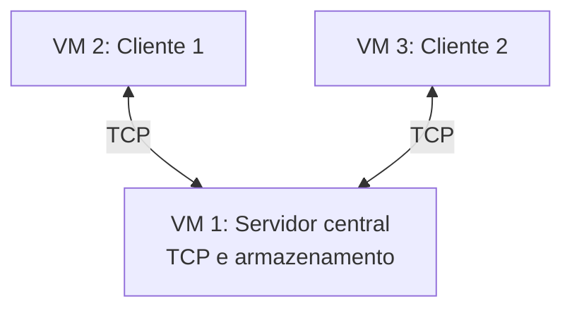

# Sistema Distribuído de Gerenciamento de Tarefas

Projeto acadêmico da disciplina de **Sistemas Distribuídos**.

## 1. Visão geral

O projeto consiste em uma aplicação cliente-servidor na qual **dois clientes independentes** se comunicam com **um servidor central** para cadastrar, consultar e atualizar tarefas. Os dados são mantidos pelo servidor e compartilhados entre os clientes.

O objetivo é demonstrar comunicação em rede, execução simultânea de clientes e acesso a dados compartilhados, incluindo uma demonstração de falha de comunicação.

> **Fonte dos requisitos:** enunciado *Projeto: Sistema Distribuído de Gerenciamento de Tarefas* (Projeto Final Alternativo). As escolhas de implementação indicadas abaixo são propostas da equipe e não exigências adicionais do enunciado.

## 2. Arquitetura



- **Servidor:** recebe conexões e solicitações, processa operações e mantém os dados das tarefas.
- **Cliente 1:** cadastra, consulta e atualiza tarefas.
- **Cliente 2:** oferece as mesmas funcionalidades e acessa os mesmos dados.
- Os clientes devem funcionar de maneira independente e poder executar simultaneamente.
- **Servidor e clientes devem ser executados em máquinas virtuais.** A proposta inicial é usar três VMs, uma para cada componente.

## 3. Requisitos funcionais obrigatórios

### Servidor

- [ ] RF01 — Inicializar e disponibilizar um serviço de comunicação.
- [ ] RF02 — Receber conexões e solicitações dos clientes.
- [ ] RF03 — Cadastrar novas tarefas.
- [ ] RF04 — Listar as tarefas existentes.
- [ ] RF05 — Atualizar o estado de uma tarefa: `pendente` ou `concluída`.
- [ ] RF06 — Manter os dados compartilhados entre os clientes.
- [ ] RF07 — Responder às solicitações com mensagens adequadas.

### Clientes

- [ ] RF08 — Conectar-se ao servidor.
- [ ] RF09 — Cadastrar uma nova tarefa.
- [ ] RF10 — Consultar a lista de tarefas.
- [ ] RF11 — Alterar o estado de uma tarefa.
- [ ] RF12 — Apresentar mensagens de sucesso ou erro.
- [ ] RF13 — Atualizar as informações exibidas a partir dos dados recebidos do servidor.

## 4. Tecnologias e decisões de implementação

**Stack principal: Java puro (Java SE 17 ou superior), sem frameworks ou bibliotecas externas.**

O enunciado sugere Python/Flask e permite sockets C/C++; a adoção de Java é uma **decisão da equipe**, que deve ser validada com a professora caso a lista de tecnologias seja restritiva.

| Camada | Tecnologia | Finalidade |
| --- | --- | --- |
| Servidor | Java SE (`ServerSocket`, `Socket`) | Aceitar conexões e processar solicitações |
| Clientes | Java SE (`Socket`, `Scanner`) | Menu no terminal e comunicação com o servidor |
| Comunicação | TCP com protocolo textual próprio | Enviar comandos e receber respostas |
| Concorrência | `ExecutorService` | Atender clientes simultâneos |
| Armazenamento | Coleção em memória no servidor | Compartilhar tarefas durante a execução |
| Ambiente | Três máquinas virtuais Linux | Isolar servidor e os dois clientes |

O armazenamento em memória é suficiente para o compartilhamento durante a execução, mas **não preserva dados após reiniciar o servidor**. Persistência em arquivo pode ser adicionada posteriormente. Para evitar condições de corrida, o acesso às tarefas deverá ser sincronizado.

## 5. Modelo de dados proposto

Exemplo de tarefa:

```json
{
  "id": 1,
  "titulo": "Estudar Sistemas Distribuídos",
  "concluida": false
}
```

O identificador distingue tarefas; `titulo` descreve a atividade; `concluida` indica seu estado. A representação interna poderá ser ajustada durante a implementação.

## 6. Protocolo de comunicação proposto

Como o projeto utilizará sockets TCP diretamente, não haverá API HTTP. O protocolo textual abaixo é uma **proposta inicial**, não uma exigência do enunciado.

| Comando enviado pelo cliente | Operação | Resposta esperada |
| --- | --- | --- |
| `CRIAR|Estudar Sistemas Distribuídos` | Cadastrar tarefa | `OK|1` |
| `LISTAR` | Consultar tarefas | `OK|1;Estudar Sistemas Distribuídos;PENDENTE` (exemplo de uma tarefa) |
| `ATUALIZAR|1|CONCLUIDA` | Alterar estado | `OK|Tarefa atualizada` |

Respostas de erro começarão com `ERRO|`. Cada mensagem será terminada por quebra de linha, e o servidor deverá validar os comandos recebidos. A codificação será UTF-8. Para simplificar o protocolo inicial, a listagem poderá retornar uma linha por tarefa e uma linha final `FIM`; o formato definitivo será documentado junto com o código.

## 7. Estrutura inicial planejada

```text
sistema-distribuido-tarefas/
├── README.md
├── .gitignore
├── src/
│   ├── servidor/
│   │   ├── Servidor.java
│   │   ├── Tarefa.java
│   │   └── RepositorioTarefas.java
│   └── cliente/
│       └── Cliente.java
├── testes/
└── docs/
    ├── arquitetura.md
    ├── execucao.md
    └── relatorio-tecnico.md
```

> Estrutura planejada: o README não cria automaticamente os arquivos Java. O mesmo código de cliente será executado em duas VMs independentes.

## 8. Preparação do repositório Git

Instale o JDK 17 ou superior nas máquinas e confira:

```bash
java -version
javac -version
```

Na raiz do projeto:

```bash
git init
mkdir -p src/servidor src/cliente testes docs
```

Sugestão para o `.gitignore`:

```gitignore
*.class
build/
out/
target/
.idea/
.vscode/
*.log
.env
```

Quando os arquivos Java forem implementados, uma compilação simples, sem Maven ou Gradle, poderá ser feita com:

```bash
mkdir -p build
javac -encoding UTF-8 -d build src/servidor/*.java src/cliente/*.java
```

Esse comando pressupõe que as classes sejam organizadas de forma compatível com a estrutura proposta. Os comandos definitivos de execução serão registrados após a implementação.

Registre a documentação inicial:

```bash
git add .
git commit -m "docs: define arquitetura em Java puro"
```

## 9. Execução planejada

A execução definitiva será documentada após a implementação. O fluxo previsto é:

1. Configurar a rede entre as três máquinas virtuais.
2. Iniciar o servidor na VM 1, permitindo acesso pela interface de rede apropriada.
3. Configurar o endereço IP e a porta do servidor nos clientes.
4. Iniciar o Cliente 1 na VM 2 e o Cliente 2 na VM 3.
5. Realizar operações nos dois clientes e verificar os dados compartilhados.

Não são fornecidos comandos de inicialização da aplicação neste momento porque o código ainda não foi implementado.

## 10. Plano de testes

- [ ] T01 — Cliente 1 cadastra uma tarefa com sucesso.
- [ ] T02 — Cliente 2 consulta e visualiza a tarefa criada pelo Cliente 1.
- [ ] T03 — Cliente 2 altera o estado da tarefa para concluída.
- [ ] T04 — Cliente 1 consulta novamente e visualiza o novo estado.
- [ ] T05 — Os dois clientes executam operações enquanto estão conectados.
- [ ] T06 — O servidor é interrompido e o cliente apresenta uma mensagem de erro apropriada.
- [ ] T07 — Após a retomada do servidor, o cliente consegue realizar uma nova solicitação.

O teste de falha é obrigatório no enunciado. Os cenários T06 e T07 são a estratégia proposta para demonstrá-lo.

## 11. Entregáveis obrigatórios

- [ ] Código-fonte do servidor e dos dois clientes.
- [ ] Diagrama da arquitetura e das comunicações.
- [ ] Instruções de execução do servidor e dos clientes.
- [ ] Relatório técnico breve: implementação, testes e problemas encontrados.
- [ ] Demonstração do sistema funcionando, com pelo menos um teste de falha.

## 12. Etapas de desenvolvimento

1. **Documentação e estrutura:** iniciar o Git, registrar requisitos e organizar diretórios.
2. **Servidor Java:** implementar `ServerSocket`, protocolo, operações sobre tarefas e armazenamento em memória.
3. **Cliente Java:** implementar `Socket`, menu, solicitações e mensagens de retorno.
4. **Integração:** testar dois clientes independentes acessando os mesmos dados.
5. **Virtualização:** executar os três componentes nas VMs e configurar a rede.
6. **Validação e entrega:** executar testes, registrar evidências, finalizar relatório e demonstrar a falha.

## 13. Critérios de conclusão

O projeto estará pronto para demonstração quando os dois clientes puderem, a partir de suas máquinas virtuais, cadastrar, consultar e atualizar tarefas mantidas pelo servidor; quando as alterações feitas por um cliente forem observáveis pelo outro após consulta; e quando uma falha de comunicação puder ser demonstrada com resposta adequada da aplicação.

---

**Estado do projeto:** documentação atualizada para Java puro — implementação pendente.
