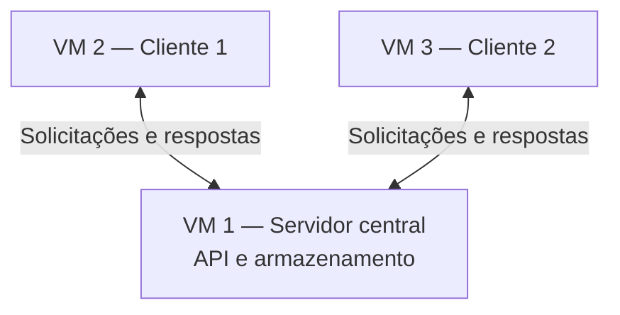

# Sistema Distribuído de Gerenciamento de Tarefas

Projeto acadêmico da disciplina **GAC129 — Prototipação de Sistemas Embarcados**, turma **70A**, semestre **2026/2**, da Universidade Federal de Lavras (UFLA).

## 1. Visão geral

O projeto consiste em uma aplicação cliente-servidor na qual **dois clientes independentes** se comunicam com **um servidor central** para cadastrar, consultar e atualizar tarefas. Os dados são mantidos pelo servidor e compartilhados entre os clientes.

O objetivo é demonstrar comunicação em rede, execução simultânea de clientes e acesso a dados compartilhados, incluindo uma demonstração de falha de comunicação.

> **Fonte dos requisitos:** enunciado *Projeto: Sistema Distribuído de Gerenciamento de Tarefas* (Projeto Final Alternativo). As escolhas de implementação indicadas abaixo são propostas da equipe e não exigências adicionais do enunciado.

## 2. Arquitetura



- **Servidor:** recebe conexões e solicitações, processa operações e mantém os dados das tarefas.
- **Cliente 1:** cadastra, consulta e atualiza tarefas.
- **Cliente 2:** oferece as mesmas funcionalidades e acessa os mesmos dados.
- Os clientes devem funcionar de maneira independente e poder executar simultaneamente.
- **Servidor e clientes devem ser executados em máquinas virtuais.** A proposta inicial é usar três VMs, uma para cada componente.

## 3. Requisitos funcionais obrigatórios

### Servidor

- [ ] RF01 — Inicializar e disponibilizar um serviço de comunicação.
- [ ] RF02 — Receber conexões e solicitações dos clientes.
- [ ] RF03 — Cadastrar novas tarefas.
- [ ] RF04 — Listar as tarefas existentes.
- [ ] RF05 — Atualizar o estado de uma tarefa: `pendente` ou `concluída`.
- [ ] RF06 — Manter os dados compartilhados entre os clientes.
- [ ] RF07 — Responder às solicitações com mensagens adequadas.

### Clientes

- [ ] RF08 — Conectar-se ao servidor.
- [ ] RF09 — Cadastrar uma nova tarefa.
- [ ] RF10 — Consultar a lista de tarefas.
- [ ] RF11 — Alterar o estado de uma tarefa.
- [ ] RF12 — Apresentar mensagens de sucesso ou erro.
- [ ] RF13 — Atualizar as informações exibidas a partir dos dados recebidos do servidor.

## 4. Tecnologias

**Sugeridas no enunciado:** Python, Flask e armazenamento em JSON ou SQLite. O documento também admite implementação direta com sockets em C/C++.

**Proposta inicial de implementação:**

| Camada | Tecnologia | Finalidade |
| --- | --- | --- |
| Servidor | Python + Flask | Disponibilizar uma API HTTP |
| Clientes | Python | Interface de terminal e envio de requisições |
| Comunicação | HTTP + JSON | Troca de mensagens entre processos |
| Armazenamento | SQLite | Manter tarefas no servidor |
| Ambiente | Máquinas virtuais Linux | Executar servidor e clientes em ambientes separados |

A interface em terminal, os endpoints e a escolha por SQLite são decisões propostas, não imposições do enunciado.

## 5. Modelo de dados proposto

Exemplo de tarefa:

```json
{
  "id": 1,
  "titulo": "Estudar Prototipação de Sistemas Embarcados",
  "concluida": false
}
```

O identificador distingue tarefas; `titulo` descreve a atividade; `concluida` indica seu estado. A representação interna poderá ser ajustada durante a implementação.

## 6. API proposta

| Método | Rota | Descrição |
| --- | --- | --- |
| `GET` | `/tarefas` | Lista as tarefas existentes |
| `POST` | `/tarefas` | Cadastra uma nova tarefa |
| `PATCH` | `/tarefas/{id}` | Altera o estado de uma tarefa |

As rotas e o formato das respostas ainda deverão ser implementados e testados. Não há endpoints funcionais nesta etapa de documentação.

## 7. Estrutura inicial planejada

```text
sistema-distribuido-tarefas/
├── README.md
├── .gitignore
├── requirements.txt
├── servidor/
│   ├── app.py
│   └── database.py
├── cliente/
│   └── main.py
├── testes/
└── docs/
    ├── arquitetura.md
    ├── execucao.md
    └── relatorio-tecnico.md
```

> **Importante:** esta é a estrutura planejada. Os arquivos e diretórios acima não são criados automaticamente pelo README. O mesmo programa cliente poderá ser executado em duas VMs independentes, sujeito à validação dessa interpretação com a professora.

## 8. Como começar e colaborar com Git

O **Git** registra o histórico das alterações. O **GitHub** hospeda o repositório e permite revisar o trabalho da equipe. Cada pessoa trabalha em uma **branch** (linha de desenvolvimento), registra alterações em **commits** e abre um **pull request (PR)** para propor sua integração à branch principal.

### 8.1. Clonar o repositório

Instale o Git e tenha uma conta no GitHub com acesso de colaboração ao repositório. No terminal, dentro da pasta em que deseja guardar o projeto, execute uma única vez:

```bash
git clone https://github.com/raipbarboza/Projeto-Sistemas-Distribuidos.git
cd Projeto-Sistemas-Distribuidos
```

O `git clone` baixa o projeto e seu histórico, além de configurar `origin`, o nome usado para o repositório remoto. Nos próximos acessos, basta abrir essa pasta no editor e no terminal.

Configure a identificação dos seus commits uma vez neste repositório, substituindo os exemplos pelos seus dados. Use um e-mail associado à sua conta do GitHub (ou o e-mail privado fornecido pelo GitHub):

```bash
git config user.name "Seu Nome"
git config user.email "seu-email@example.com"
```

### 8.2. Criar uma branch para a tarefa

Antes de começar, combine a tarefa com a equipe e confira se não há alterações pendentes com `git status`. Os exemplos usam `main` como branch principal; se o repositório usar outro nome, substitua-o nos comandos.

```bash
git switch main
git pull --ff-only origin main
git switch -c feat/cadastro-tarefas
```

O `pull` atualiza sua cópia com o trabalho já integrado. O `switch -c` cria e seleciona uma nova branch. Escolha um nome por tarefa, como `feat/listagem-tarefas`, `fix/erro-conexao` ou `docs/instrucoes-execucao`. Faça as alterações na branch da tarefa.

### 8.3. Conferir, registrar e enviar alterações

Depois de editar os arquivos e testar o que mudou:

```bash
git status
git diff
git add caminho/do/arquivo
git diff --staged
git commit -m "feat: adiciona cadastro de tarefas"
git push -u origin feat/cadastro-tarefas
```

Substitua `caminho/do/arquivo` pelo arquivo alterado e repita o `git add` para cada arquivo da tarefa. O `diff` mostra as mudanças; o `add` seleciona o que entrará no commit; o `diff --staged` permite revisar essa seleção; o `commit` registra o trabalho localmente; e o `push` envia os commits ao GitHub.

Use mensagens curtas que expliquem a alteração, com prefixos como `feat:` (funcionalidade), `fix:` (correção) ou `docs:` (documentação). Confira os arquivos antes de enviar: ambientes virtuais, senhas, arquivos `.env` e bancos locais devem ficar fora dos commits e ser cobertos pelo `.gitignore`.

### 8.4. Abrir e revisar um pull request

1. Acesse o repositório no GitHub e clique em **Compare & pull request**, ou em **Pull requests > New pull request**.
2. Escolha `main` como destino (**base**) e a branch da tarefa como origem (**compare**).
3. Informe um título claro e descreva o que mudou, como testar e quais pendências existem. Vincule a issue da tarefa, se houver.
4. Abra o PR e solicite a revisão de outra pessoa da equipe. Para trabalho ainda incompleto, use **Draft pull request**.
5. Responda aos comentários e faça os ajustes na mesma branch. Novos commits enviados com `git push` atualizam o PR automaticamente.
6. Após a revisão e a validação, a pessoa responsável pela integração faz o **merge**, incorporando as alterações à `main`.

Modelo de descrição do PR:

```markdown
## O que mudou
- Descreva a alteração e a tarefa atendida.

## Como testar
1. Liste os passos para verificar o resultado.

## Resultado da validação
- Registre os testes executados e seus resultados.

## Pendências
- Informe o que falta ou escreva "Nenhuma".
```

Depois do merge, com o trabalho local já registrado e sem alterações pendentes:

```bash
git switch main
git pull --ff-only origin main
git branch -d feat/cadastro-tarefas
```

O último comando remove a branch local concluída. Se o Git recusar a exclusão, mantenha a branch e peça ajuda à equipe para conferir a integração. Para a próxima tarefa, crie uma nova branch a partir da `main` atualizada.

Se houver conflito, o Git indicará os arquivos envolvidos. Combine com quem alterou esses arquivos qual conteúdo deve permanecer, remova as marcações de conflito e teste o resultado antes de concluir a integração. Se um comando falhar ou houver dúvida, compartilhe a mensagem com a equipe antes de tentar sobrescrever o histórico.

### 8.5. Preparar o ambiente Python

Na pasta do repositório, crie o ambiente virtual:

```bash
python -m venv .venv
```

No Linux, use `python3` se necessário e ative com `source .venv/bin/activate`. No Windows com PowerShell, ative com `.\.venv\Scripts\Activate.ps1`.

Após a criação do `requirements.txt` e a definição das dependências, execute com o ambiente ativado:

```bash
pip install -r requirements.txt
```

## 9. Execução planejada

A execução definitiva será documentada após a implementação. O fluxo previsto é:

1. Configurar a rede entre as três máquinas virtuais.
2. Iniciar o servidor na VM 1, permitindo acesso pela interface de rede apropriada.
3. Configurar o endereço IP e a porta do servidor nos clientes.
4. Iniciar o Cliente 1 na VM 2 e o Cliente 2 na VM 3.
5. Realizar operações nos dois clientes e verificar os dados compartilhados.

Não são fornecidos comandos de inicialização da aplicação neste momento porque o código ainda não foi implementado.

## 10. Plano de testes

- [ ] T01 — Cliente 1 cadastra uma tarefa com sucesso.
- [ ] T02 — Cliente 2 consulta e visualiza a tarefa criada pelo Cliente 1.
- [ ] T03 — Cliente 2 altera o estado da tarefa para concluída.
- [ ] T04 — Cliente 1 consulta novamente e visualiza o novo estado.
- [ ] T05 — Os dois clientes executam operações enquanto estão conectados.
- [ ] T06 — O servidor é interrompido e o cliente apresenta uma mensagem de erro apropriada.
- [ ] T07 — Após a retomada do servidor, o cliente consegue realizar uma nova solicitação.

O teste de falha é obrigatório no enunciado. Os cenários T06 e T07 são a estratégia proposta para demonstrá-lo.

## 11. Entregáveis obrigatórios

- [ ] Código-fonte do servidor e dos dois clientes.
- [ ] Diagrama da arquitetura e das comunicações.
- [ ] Instruções de execução do servidor e dos clientes.
- [ ] Relatório técnico breve: implementação, testes e problemas encontrados.
- [ ] Demonstração do sistema funcionando, com pelo menos um teste de falha.

## 12. Cronograma e prazos do projeto final

Conforme o **Plano de Ensino de GAC129 — Prototipação de Sistemas Embarcados, turma 70A, semestre 2026/2**, na seção *Cronograma de Atividades* (páginas 4 e 5):

| Atividade | Datas previstas |
| --- | --- |
| Desenvolvimento do projeto prático final | 31/10/2026; 04, 05, 07, 18, 19, 21 e 25/11/2026 |
| Entrega de relatórios | **26/11/2026 e 28/11/2026** |
| Apresentação do projeto prático final | **02, 03, 05, 07, 08 e 10/12/2026** |

O período de 11 a 14/11/2026 está reservado ao Congresso Unificado da UFLA, com atividades previstas nos dias 11, 12 e 14/11.

## 13. Etapas de desenvolvimento

1. **Documentação e estrutura:** registrar requisitos, organizar diretórios e preparar a colaboração no repositório.
2. **Servidor:** implementar comunicação, operações sobre tarefas e armazenamento.
3. **Cliente:** implementar menu, solicitações e mensagens de retorno.
4. **Integração:** testar dois clientes independentes acessando os mesmos dados.
5. **Virtualização:** executar os três componentes nas VMs e configurar a rede.
6. **Validação e entrega:** executar testes, registrar evidências, finalizar relatório e demonstrar a falha.

### Plano de trabalho da equipe

Cada etapa será dividida em tarefas pequenas, com uma pessoa responsável, resultado esperado e critério de conclusão. Registrar as tarefas nas **Issues** do GitHub e acompanhar os estados **A fazer**, **Em andamento**, **Em revisão** e **Concluído**. A pessoa responsável pela organização acompanha prioridades e dependências, esclarece requisitos com a equipe e coordena as revisões.

| Frente | Sugestões de tarefas para issues e PRs | Validação esperada |
| --- | --- | --- |
| Documentação e estrutura | Criar diretórios, definir dependências e documentar arquitetura | Estrutura e instruções revisadas pela equipe |
| Servidor | Separar cadastro, listagem, atualização e armazenamento em tarefas | Operações verificadas e dados compartilhados corretamente |
| Cliente | Implementar menu, chamadas ao servidor e mensagens de erro | Fluxos executados pelo terminal |
| Integração | Testar os dois clientes e o cenário de falha | Evidências dos cenários do plano de testes |
| Virtualização | Configurar VMs, rede e instruções de execução | Comunicação entre as três VMs |
| Entrega | Consolidar relatório, diagrama e roteiro da demonstração | Entregáveis revisados conforme o cronograma |

Fluxo de cada tarefa:

1. **Combinar:** definir escopo, responsável, dependências e como verificar o resultado na issue.
2. **Desenvolver:** atualizar a `main`, criar uma branch e implementar somente o escopo combinado.
3. **Validar:** testar a alteração e registrar os resultados no PR, incluindo a documentação necessária.
4. **Revisar:** outra pessoa lê o PR, verifica o resultado e solicita ajustes quando necessário.
5. **Integrar:** realizar o merge após aprovação e marcar a tarefa como concluída. Usar `Closes #numero` na descrição do PR para fechar a issue automaticamente quando ele for integrado à branch padrão.

Priorizar PRs pequenos para facilitar a leitura e o aprendizado. Antes de alterar arquivos que outra pessoa está modificando, alinhar a divisão do trabalho. Uma tarefa só está concluída quando foi validada, revisada e integrada.

## 14. Critérios de conclusão

O projeto estará pronto para demonstração quando os dois clientes puderem, a partir de suas máquinas virtuais, cadastrar, consultar e atualizar tarefas mantidas pelo servidor; quando as alterações feitas por um cliente forem observáveis pelo outro após consulta; e quando uma falha de comunicação puder ser demonstrada com resposta adequada da aplicação.

---

**Estado do projeto:** documentação inicial — implementação pendente.
